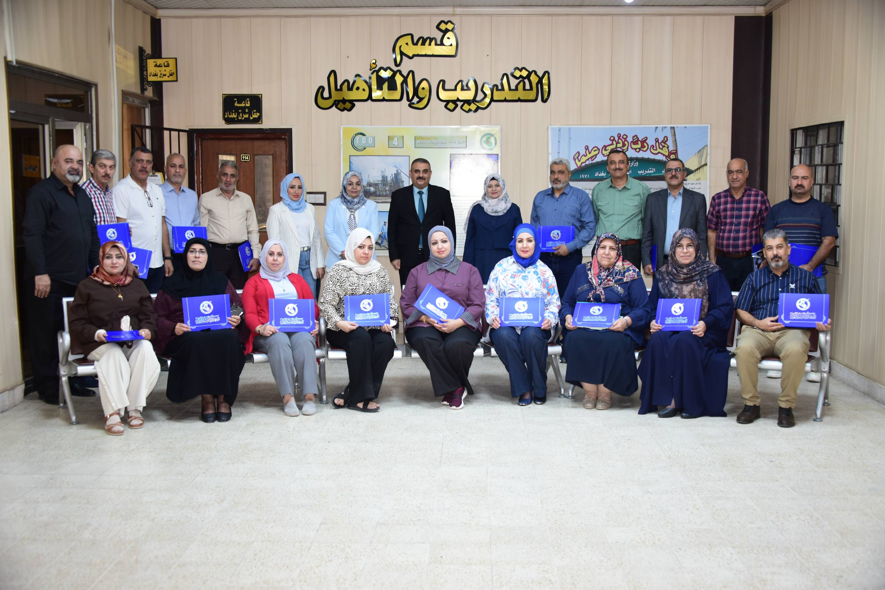
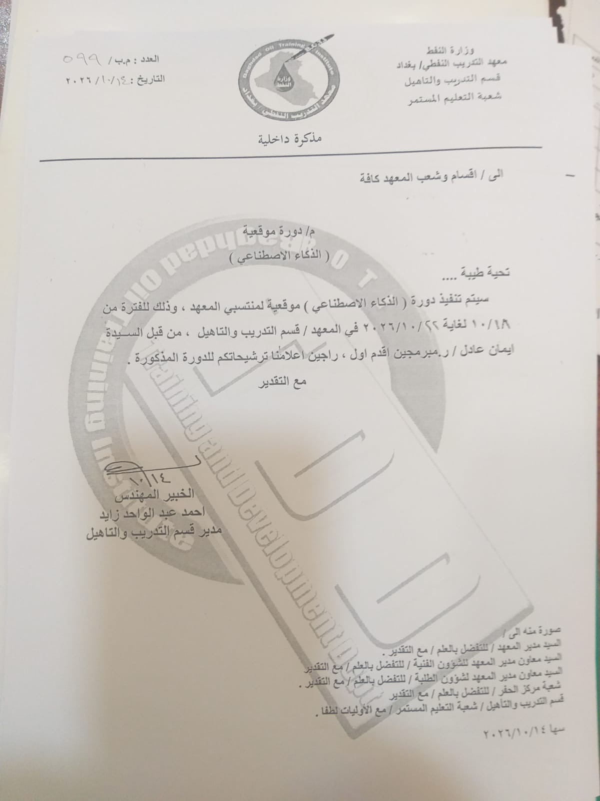
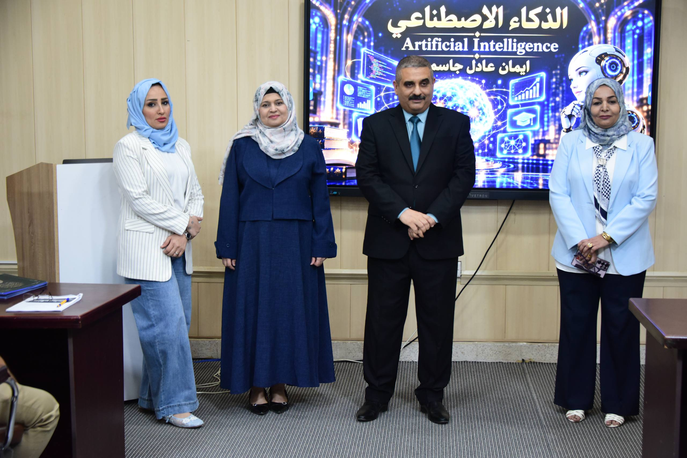
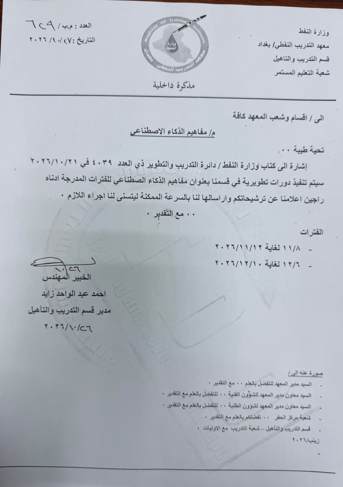

# الدورات التدريبية في الذكاء الاصطناعي
## إيمان عادل جاسم

**معهد التدريب النفطي / بغداد — قسم التدريب والتأهيل**

ملف توثيقي للدورات التدريبية التي أقدّمها في مجال الذكاء الاصطناعي، يجمع بيانات الدورة المنفّذة والتعاميم المرتبطة بها وصور اختتامها، إلى جانب مواعيد الدورات المقبلة، لتيسير الاطلاع على النشاط التدريبي ومتابعته.

**حالة التوثيق بتاريخ: 29 تشرين الأول 2026.**

## نبذة عن النشاط التدريبي

يأتي هذا النشاط في إطار نشر المعرفة بالذكاء الاصطناعي وتنمية قدرات المنتسبين على مواكبة التقنيات الحديثة، ودعم التوجّه نحو التحول الرقمي في بيئة العمل.

يتضمن السجل دورة منفّذة لمنتسبي معهد التدريب النفطي / بغداد، ودورتين مقررتين بعنوان «مفاهيم الذكاء الاصطناعي». وقد عُمّمت الدورتان المقبلتان من قبل وزارة النفط على الشركات النفطية، ثم عُمّمتا داخل المعهد، وسأتولى تقديمهما وفق المواعيد المحددة.

## الدورة المنفّذة

| البيان | التفاصيل |
| --- | --- |
| عنوان الدورة | الذكاء الاصطناعي |
| المدرّبة | إيمان عادل جاسم |
| الجهة | معهد التدريب النفطي / بغداد |
| مكان التنفيذ | قسم التدريب والتأهيل |
| الفترة | من 18 إلى 22 تشرين الأول 2026 |
| الفئة المشاركة | منتسبو معهد التدريب النفطي / بغداد |
| عدد المشاركين | 21 مشاركًا |
| حالة الدورة | منفّذة |

تم تقديم الدورة للفترة المبينة أعلاه بمشاركة 21 من منتسبي المعهد. ويوثّق هذا القسم تعميم الدورة وصور اختتامها.

### تعميم الدورة

مذكرة داخلية صادرة عن معهد التدريب النفطي / بغداد، قسم التدريب والتأهيل، شعبة التعليم المستمر، بتاريخ 14 تشرين الأول 2026، تتضمن الإعلان عن الدورة وفترة تنفيذها واسم المدرّبة.

[عرض تعميم الدورة بالحجم الكامل](completed-course-memo.jpg)

### صور اختتام الدورة

*جانب من اختتام دورة الذكاء الاصطناعي.*

*الصورة الجماعية في اختتام الدورة لدى قسم التدريب والتأهيل.*

## الدورات المقبلة

سأتولى تقديم دورتين بعنوان **«مفاهيم الذكاء الاصطناعي»** وفق الجدول التالي:

| الدورة | تاريخ البدء | تاريخ الانتهاء | الحالة |
| --- | --- | --- | --- |
| مفاهيم الذكاء الاصطناعي — الدورة الأولى | 8 تشرين الثاني 2026 | 12 تشرين الثاني 2026 | مقررة — لم تُنفّذ بعد |
| مفاهيم الذكاء الاصطناعي — الدورة الثانية | 6 كانون الأول 2026 | 10 كانون الأول 2026 | مقررة — لم تُنفّذ بعد |

### مذكرة تعميم الدورتين

المرفق أدناه هو مذكرة المعهد الداخلية بتاريخ 27 تشرين الأول 2026، الموجّهة إلى أقسام المعهد وشعبه كافة. وتشير المذكرة إلى كتاب وزارة النفط / دائرة التدريب والتطوير المؤرخ في 21 تشرين الأول 2026، وتحدد فترتي الدورتين وتطلب إرسال الترشيحات.

[عرض مذكرة الدورتين بالحجم الكامل](upcoming-courses-memo.jpg)

## مصادر التوثيق

- المذكرات المرفقة: توثّق إعلان الدورات والفترات المحددة لها.
- صور الاختتام: توثيق مصوّر للدورة المنفّذة، مقدّم من المدرّبة.
- عدد المشاركين، تنفيذ الدورة، وتعميم الدورتين على الشركات النفطية وتولّي تقديمهما: بيانات مقدّمة من المدرّبة إيمان عادل جاسم.

سيُحدّث هذا السجل بعد تنفيذ الدورات المقبلة بإضافة بيانات المشاركة وصور التوثيق المتاحة.

---

**إعداد وتوثيق: إيمان عادل جاسم / رئيس مبرمجين اقدم اول**  
معهد التدريب النفطي / بغداد

